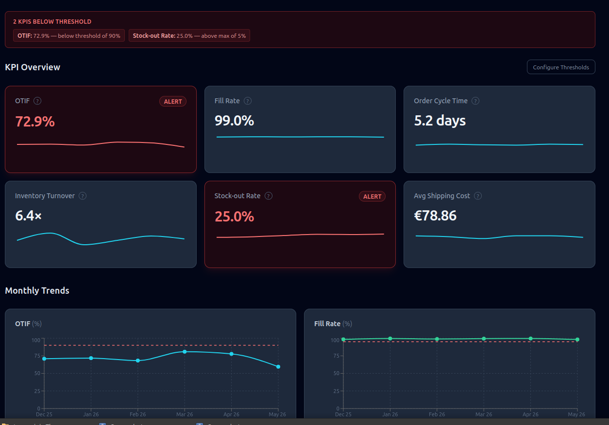
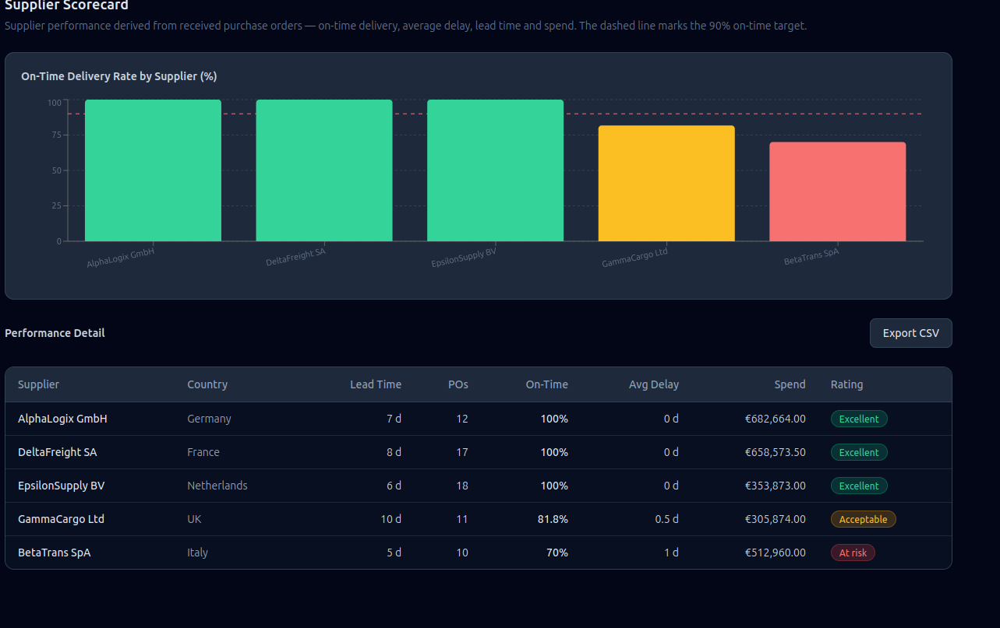
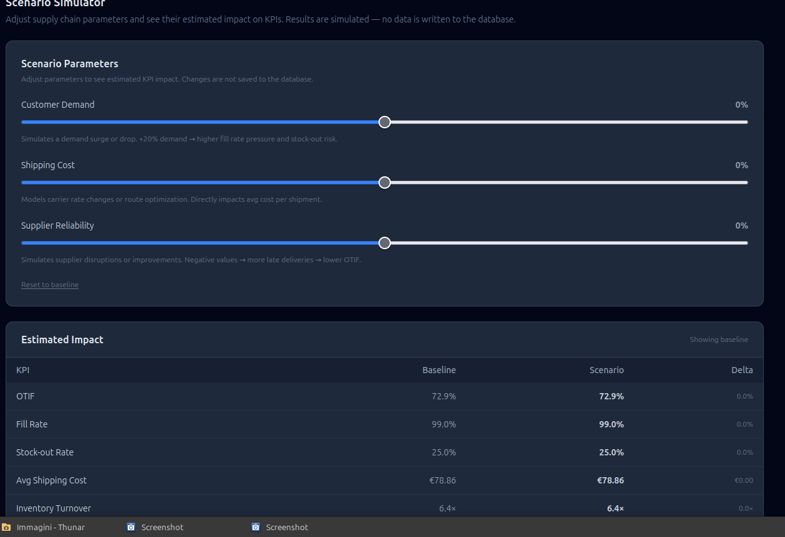

# Logistics Control Tower

A configurable React + Supabase logistics dashboard starter. Includes synthetic
sample data, KPI calculations, illustrative scenarios and billing integration.
Version 1.0.0 is a **release candidate**, subject to RELEASE_CHECKLIST.md.

## Included

- React 18, TypeScript, Vite, Tailwind CSS and Recharts.
- KPI dashboard: OTIF, order cycle time, fill rate, inventory turnover,
  stock-out indicator and average shipping cost.
- Searchable/filterable orders, supplier scorecard, scenario controls and CSV.
- Supabase email/password Auth, per-user workspaces, migrations and RLS.
- Server-verified Stripe Checkout/Customer Portal, current subscription state
  synchronization and a first-subscription trial.
- Optional authenticated welcome email through your verified Resend sender.
- Single-seat commercial source license, tests and deployment/packaging configs.

Each user has a separate workspace. Shared organization/team workspaces, SSO,
ERP connectors, live data ingestion and a validated forecasting engine are not
included. Free/Pro gates in the UI do not implement source-code DRM.

## Start

Use Node **24.22.1** (.nvmrc). Create your own staging Supabase and Stripe sandbox
accounts and follow **[supabase/SETUP.md](supabase/SETUP.md)** in full, including
all migrations and all four functions. Copy .env.example to .env.local and supply
your own public Supabase URL/key. Backend secrets stay in Supabase, never VITE_.

```sh
npm ci --ignore-scripts
npm run check
npm run dev
```

A new empty account receives synthetic sample data automatically. Replace this
demo behavior before connecting real operations. Demo scenario results are
illustrative and should not be used as validated business forecasts.

## Checks and builds

```sh
npm test                 # KPI, billing boundary, PostgreSQL RLS/RPC, packaging
npm run test:edge        # real Stripe SDK signature verification/tamper rejection
npm run check:edge       # strict Deno checking of deployed entrypoints
npm run build            # frontend production assets
npm audit
```

The automated PostgreSQL tests use PGlite and a minimal Supabase Auth fixture.
They do not certify hosted Auth, Stripe account configuration, actual payments
or verified email delivery. Complete the staging acceptance gate before release.

Supabase, Stripe, Resend and hosting are third-party services configured and paid
for separately. Example EUR 9/month SaaS labels must match your own Stripe price;
the suggested USD 79 source-code price is a separate seller decision.

## Screenshots

Screenshots show an earlier sample-data UI and are illustrative. Re-capture the
accepted release before using images in a product listing.





## Source release (maintainer workflow in a Git checkout)

Commit all reviewed changes first. Packaging reads only the chosen Git commit and
the explicit allowlist in release.manifest.json, not local working-folder contents.
It excludes Git history, credentials, node_modules, build output and the seller's
Gumroad listing guide, and records source checksums in RELEASE.json.

```sh
npm run package:release -- --ref HEAD
npm run verify:archive -- release/logistics-control-tower-1.0.0.zip
```

The verification command extracts into a temporary directory, validates hashes,
installs the pinned dependencies and runs all automated checks plus the build.
The generated .sha256 file identifies the ZIP. Publication is a separate action
requiring the hosted and commercial checks in RELEASE_CHECKLIST.md. For an
approved or downloaded candidate, add `--expected-commit FULL_SHA
--expected-sha256 ZIP_SHA256` to verification, replacing both placeholders from
the separately approved release record. Internal file hashes alone do not prove
that a ZIP is the approved candidate.

GitHub Actions also runs these checks and uploads the verified ZIP and checksum
as an artifact of each successful **push** run (retained for 14 days). Download
the artifact named with the reviewed commit from the "Release candidate checks"
workflow. Extract GitHub's outer artifact container; the inner project ZIP is the
file to review/upload to Gumroad. Pull-request merge test runs do not upload a
sale candidate. A downloadable artifact is not approval to publish it.

## License and support

See LICENSE for one named developer seat, unlimited projects and permitted client
delivery. Extra developers need extra seats. No team-tier variant is included.
Third-party dependencies retain their own terms; see THIRD_PARTY_NOTICES.md.

Commercial support: contact the seller through your purchase receipt. Public
issues must contain only sanitized reproductions, never keys, personal data or
billing session links. There is no support SLA or guaranteed future roadmap.
